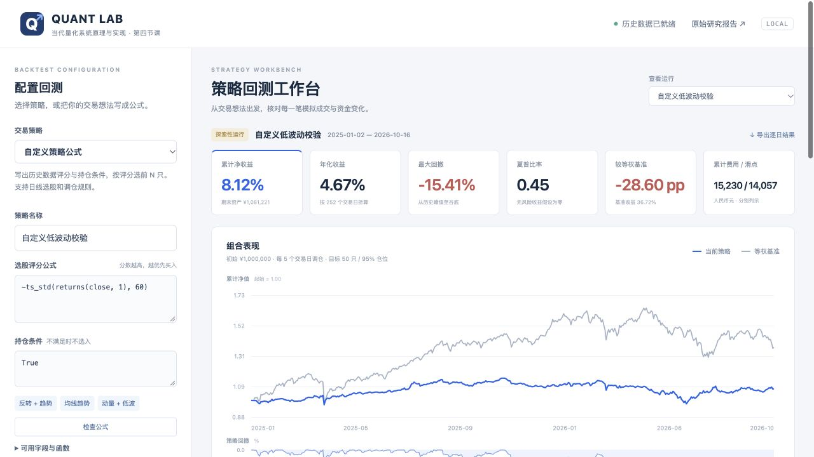

# 第四节课作业：日线回测系统与交易策略挖掘

更新日期：2026-10-23。状态：完成课程指定资金、日期、历史 ST 过滤及退出核算；本策略未证明正超额。最新入口为 [作业简报](assignment/REPORT.md) 和 [一页实验记录](assignment/report.html)。原先的 [研究报告](REPORT.md) 与 `results/` 保留其原始口径，两次结果分别展示。来源为老师的作业要求、课程原始数据和本项目实际运行。

## 本次课程作业怎样复现

老师要求剔除 ST/*ST，10 亿元初始资金，佣金单边万一、卖出印花税万五，2025 年首个交易日开始建仓，2026 年 9 月最后一个交易日离场。本次对应 **2025-01-02 至 2026-09-30，共 424 个数据交易日**。评分沿用此前选出的 60 日低波动；末 20 日逐步退出。详细成本、容量、持仓、回顾性修订和局限见简报及 [参数](assignment/protocol.json)。

先安装 [运行依赖](requirements.txt)，另安装 `baostock==0.9.4` 用于匿名直接查询历史状态。课程 ZIP 放在本地 `lesson-04/data/feathers.zip`（不入 Git）；[课程原始下载](https://github.com/aslan9/pku_quantllm/releases/download/data-backtest-20261016/feathers.zip) 的 SHA-256 应为 `5766950f2a105244867b842709cf4bad890e4e11df0eebeeaa4fec42dc05803d`。

```bash
python3 lesson-04/fetch_status.py --data lesson-04/data/feathers.zip
python3 lesson-04/course.py
python3 lesson-04/course_report.py
python3 -m pytest -q lesson-04/tests
python3 lesson-04/server.py --data lesson-04/data/feathers.zip --port 8767
```

`fetch_status.py` 直接向 BaoStock 查询，逐股 CSV 可中断后续传；完成后形成 `data/status.parquet` 与查询记录，未知状态不买入。网页启动时若存在这份数据，默认展示课程作业结果，支持相同规则下的自定义公式回测。没有历史状态文件时仅提供原始研究模式。公式能力限于日频评分、条件与调仓，不支持任意 Python 或盘中订单。

本次 [现金账本](assignment/selected_daily.csv)、[订单](assignment/selected_orders.csv.gz)、[持仓快照](assignment/selected_holdings.csv.gz)、[检查](assignment/checks.json) 和来源哈希可公开核对。等权对照的完整逐单和逐股快照保留本地，可通过 `course.py` 重建；避免将上百万行重复成交数据塞入 Git。课程数据及查询得到的状态宽表也留在本地。

## 打开可操作的回测网页

网页工作台支持选择已有策略、编写新的评分公式与持仓条件、调整日期/持仓数/调仓间隔/成本、实际运行回测，并查看净值、回撤、委托、持仓快照与每日账本。可搜索股票代码、切换本次服务中的运行记录、导出 CSV。前端页面连接 [server.py](server.py) 的本地回测接口，使用与研究报告相同的 [引擎](engine.py)。



```bash
OPENBLAS_NUM_THREADS=1 OMP_NUM_THREADS=1 \
  python3 lesson-04/server.py --data /path/to/feathers.zip --port 8767
```

安装依赖后运行，浏览器打开 [本机回测工作台](http://127.0.0.1:8767)。该地址需要本机服务正在运行；首次读取 7 份行情时仍可查看既有结果，数据就绪后可提交新回测。服务仅监听本机。新回测保存于被 Git 忽略的 `runtime/`，不覆盖原始 `results/`；运行选择列表为当前服务会话，CSV 与设置文件会保留在磁盘。

在“交易策略”选择 **自定义策略公式**，输入评分与条件。例如评分 `-returns(close, 5)`，条件 `close > ts_mean(close, 20)`，表示在价格高于 20 日均线的股票中，优先买过去 5 日跌幅较大的股票。先检查公式，再运行。完整语法和更多例子见 [自定义策略指南](strategy-guide.md)。

新界面中的交互运行统一标为探索性研究，避免把看过的历史数据再次称为独立留出。原始冻结实验可在运行列表中切回；网页右上角的研究报告为既有静态研究结果。

## 看结果

- [可视化报告](report.html)：离线 HTML，包含净值、回撤、仓位、全部验证候选和成本敏感性。
- [中文实测报告](REPORT.md)：实际数字、验证结论、数据问题、成交与记账假设。
- [完整指标与门槛](results/summary.json)、[全部候选](results/candidates.csv)、[所选策略逐单账本](results/test_selected_orders.csv)、[逐日资金](results/test_selected_daily.csv)、[持仓](results/test_selected_holdings.csv)。
- [等权基准逐单账本](results/test_equal_weight_orders.csv.gz)、[等权基准持仓](results/test_equal_weight_holdings.csv.gz)：无损 gzip 压缩，可直接由 `pandas.read_csv` 读取。
- [第四节 Wiki 入口](../wiki/lessons/lesson-04.md)：两个任务的交付与证据边界。

本课与第二节、第三节独立。原压缩包保留在用户提供的位置，不解压到仓库、不修改、不上传。默认运行路径是本地文件参数，没有网络行情、实盘接口或凭证。

## 一次运行

Python 3.12 实测，依赖为 NumPy、pandas、PyArrow、Matplotlib 和 pytest。现有环境满足时可直接运行；新环境按下面安装。

```bash
python3 -m venv lesson-04/.venv
lesson-04/.venv/bin/python -m pip install -r lesson-04/requirements.txt
lesson-04/.venv/bin/python -m pytest -q lesson-04/tests
MPLCONFIGDIR=/tmp/lesson04-mpl OPENBLAS_NUM_THREADS=1 OMP_NUM_THREADS=1 \
  lesson-04/.venv/bin/python lesson-04/run.py --data /path/to/feathers.zip
```

也可用已安装依赖的 `python3` 替换环境路径。运行会按相同方案重新生成本目录的报告和结果；如需保留此前运行，添加 `--output /path/to/new-run`，不会更改原数据。代码从本目录的 [protocol.json](protocol.json) 读取冻结设置；输出中保存该设置、源码哈希和实际环境。改变方案后应另存结果，并承认既有最终测试已被查看。

## Task 1：回测系统

| 模块 | 作用 | 可核对输出 |
| --- | --- | --- |
| [data.py](data.py) | 精确读取 7 个真实成员，检查日期/代码轴、哈希、覆盖、OHLC、缺失及复权 | [数据审计](results/data_audit.json)、[按日覆盖](results/data_coverage.csv) |
| [signals.py](signals.py) | 当日及历史特征、动态证券池、排序与下一开盘目标 | [所有候选开发/验证收益](results/candidate_daily_returns.csv) |
| [engine.py](engine.py) | 开盘调仓、现金/份额账本、容量、费用、滑点、缺价、受阻订单 | [逐单账本](results/test_selected_orders.csv)、[持仓](results/test_selected_holdings.csv) |
| [run.py](run.py) | 先选择后测试、预定基准与成本敏感性、资金/持仓核对 | [选择记录](results/selection.json)、[完整性检查](results/integrity_checks.json) |
| [report.py](report.py) | 从实际结果生成中文报告、离线 HTML 和 PNG/SVG/PDF | [报告](REPORT.md)、[图表](figures/final-test.png) |
| [server.py](server.py) / [网页](web/index.html) | 本地回测接口、参数验证、异步运行、查询与导出 | 启动后的网页和 `runtime/` 运行文件 |
| [formula.py](formula.py) | 解析自定义公式，仅允许白名单历史运算，禁止未来引用与任意 Python | [语法与使用方法](strategy-guide.md) |
| [测试](tests/test_backtest.py) | 可手算成交、现金、税率日期、因果性、缺价、拆股、费用和容量 | `python3 -m pytest -q lesson-04/tests` |

**回测**是在固定历史行情和明确成交假设下模拟资产变化。例如前一日跌幅靠前的 50 只股票，次日开盘才买；不能在已经知道当天收盘跌幅后假定按当天开盘买到。回测区别于逐笔历史回放，也区别于真实撮合，当前作用是比较固定策略的可复现研究结果。

使用 `raw_price * cumadj` 作为复权价格，按连续复权份额记账，允许小数。送股/分红没有明细，因此没有伪造原始股数或现金分红流水；真实整手、最低佣金和权益分派仍待实现。费用、成交限额和缺价处理见 [实测报告](REPORT.md) 的“账本与成交假设”。

## Task 2：18 个固定候选与验证

所有公式在日 t 收盘后计算，越大越优；`C/O/H/L` 为复权收/开/高/低，`r` 为日收盘收益，`A` 为成交额，`N` 为成交笔数；窗口均为交易日。缺失不后填，不使用未来价格。

| 候选 | 公式/直觉 |
| --- | --- |
| `reversal_1/3/5/10` | `−(C[t]/C[t-k]−1)`：买近期跌幅较大的股票 |
| `momentum_20/60` | `C[t]/C[t-k]−1`：买近期涨幅较大的股票 |
| `momentum_120_skip5` | `C[t-5]/C[t-120]−1`：较长动量，跳过最近 5 日 |
| `low_vol_20/60` | `−std(r,k)`：买历史波动较小的股票 |
| `low_amount_20/high_amount_20` | `∓log(mean(A,20))`：低/高成交额，可能含规模与流动性暴露 |
| `range_reversal_5/20` | `−(C−min(L,k))/(max(H,k)−min(L,k))`：买接近历史区间低位的股票 |
| `gap_reversal_1/5` | `−mean(O[t]/C[t-1]−1,k)`：买过去跳空较弱的股票 |
| `low_trade_size_20/high_trade_size_20` | `∓log(mean(A/N,20))`：平均每笔成交金额，无法识别真实大户/散户 |
| `reversal5_lowvol20` | 5 日反转与 20 日低波动在当时可投资池内的百分位排名等权平均 |

**样本外验证**是用没有参与策略选择的后续时期检验固定方法。例如 2023–2024 选反转或动量后，把选中的公式固定，再评估 2025 起数据；不能看了 2025 收益再换方向。本次分期在运行前写入 [方案](protocol.json)：2020–2022 开发诊断（含前 120 个有效观察的预热）；2023–2024 按扣费夏普选唯一候选；2025 起至文件末日为最终测试。没有机器学习训练步骤，因此“开发期”不代表拟合模型。

默认每 5 日调仓、前 50 只等权、目标 95% 仓位。可投股票必须当时具备至少 120 个有效观察、最近 20 日连续有效、价格至少 2 元、20 日平均成交额至少 2,000 万元；不按期末存续筛选。基准为同样证券池的动态等权组合和成交额最高的 50 只。它们是自建基准，不能当作沪深 300 或市场官方指数。

**夏普**是日均净收益除以日收益波动再乘 `sqrt(252)`，本次无风险收益假设为零；**最大回撤**是含初始资金在内的峰值到谷底最大亏损；**换手**是买卖名义额与净值的比值，本报告年化单边换手是双边换手除以二。比如从 100 万涨到 120 万，再跌到 90 万，回撤为 −25%，不是相对初始的 −10%。这些量分别描述波动调整收益、下行路径和交易成本压力。

通过门槛事先固定为：最终测试夏普 >0.5、年化收益正、总收益超过同条件等权、配对 20 日块自助法的年化算术平均超额 95% 区间下限正、双倍成本仍超过同成本等权。即便满足，也只能称“在当前数据与假设下通过统计门槛”，无法替代真实成交与后续独立期间验证。最终测试不评其余候选，不用测试数据再选赢家。

## 证据边界

原始 `results/` 实验没有历史 ST 状态；10 月 23 日的 `assignment/` 运行已直接补充历史 ST/停牌字段。原包累计复权和成交额字段含义已由课程说明确认，但小数复权份额如何对应真实分红到账仍属研究近似。完整涨跌停、分红、开盘深度、行业/市值仍未补齐。4.8% 跳空保护不是交易所完整规则。原始实验采用 20 日缺价归零；课程作业改为保留最后有效估值，未用估值归零制造清仓。全日成交额是否为零只作日线有效性判断，仓位容量使用前日已知成交额。策略有效性和十亿元实盘容量均未证明。

自动化测试与完整性核对验证实现是否遵守设定，不能证明策略一定盈利。所有失败与不确定性保留在报告和 Wiki。未进行实盘或 GitHub 发布。

[交付检查记录](results/delivery_checks.json) 保存重复运行数值一致性、链接/索引、无损压缩和图表人工查看结果。两次运行使用同一冻结方案，第二次为工程复现，不是新的独立金融测试。

[网页验收记录](results/workbench_checks.json) 单独记录自定义公式与原引擎的实数据一致性、公式限制、浏览器运行/导出及响应布局检查。完整测试命令同时包含原引擎和新增公式/接口测试。
