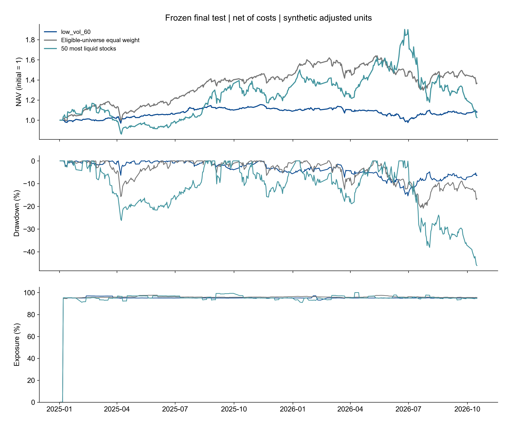
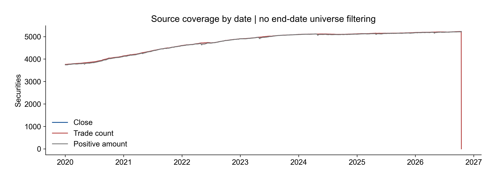
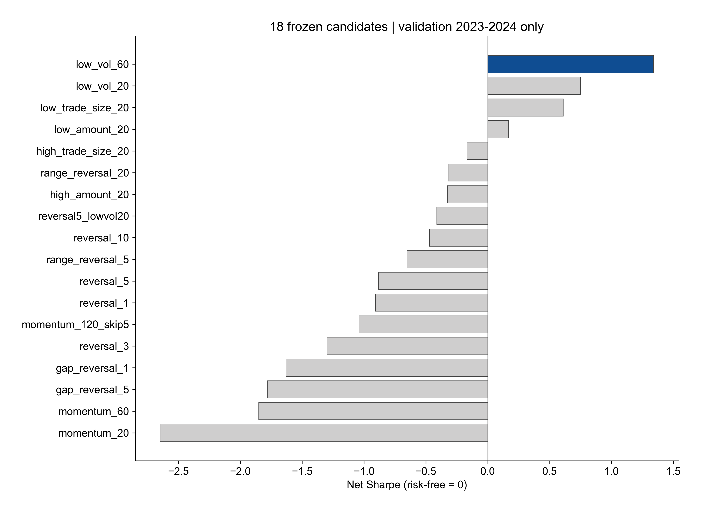
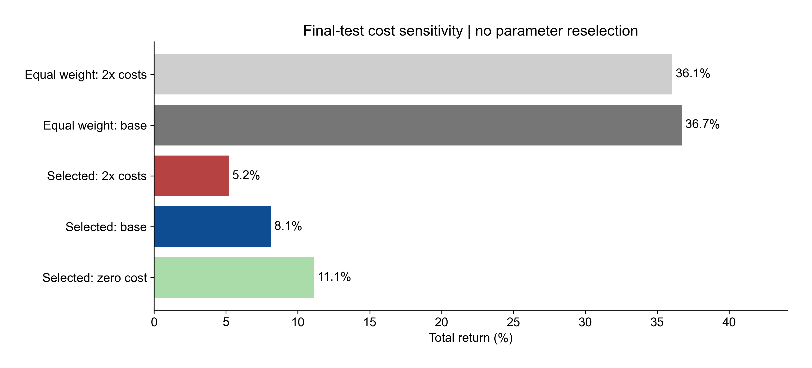

# 第四节课：回测系统与策略验证实测报告

更新日期：2026-10-16。状态：本地实现、全量运行与工程检查完成；教师验收待确认。来源：[原始数据审计](results/data_audit.json)、[冻结方案](protocol.json)、[选择记录](results/selection.json)、[完整汇总](results/summary.json)。

## 结果

**未通过预设策略验证门槛。** 验证期按扣费夏普选中 `low_vol_60`，最终测试为 2025-01-01 至 2026-10-16，共 431 个交易日。测试扣费总收益 8.12%，年化 4.67%，夏普 0.45，最大回撤 -15.41%。同期可投股票池等权基准总收益 36.72%，两者总收益差 -28.60%（百分点差，非相对收益率）。2026 是截至数据末日的部分年度。

| 测试方案 | 总收益 | 年化收益 | 夏普 | 最大回撤 | 年化单边换手 |
| --- | ---: | ---: | ---: | ---: | ---: |
| selected_zero_cost | 11.12% | 6.36% | 0.59 | -14.60% | 7.7 |
| selected | 8.12% | 4.67% | 0.45 | -15.41% | 7.7 |
| selected_stress | 5.21% | 3.01% | 0.32 | -16.21% | 7.7 |
| equal_weight | 36.72% | 20.06% | 0.97 | -20.84% | 1.4 |
| equal_weight_stress | 36.05% | 19.72% | 0.96 | -20.90% | 1.4 |
| liquid_50 | 2.61% | 1.52% | 0.23 | -46.05% | 6.9 |

策略与等权基准的逐日净收益配对差，20 日循环块自助法 2,000 次，年化算术平均超额的 95% 区间为 [-42.97%, 16.60%]。这不是年化复合超额，也不是 18 个候选的多重检验校正；候选只用 2023–2024 选择，最终测试未用于改方向、参数或赢家。区间仍依赖平稳性假设，未调整股票行业、市值或风格暴露。

## 数据与发现

- 原文件只读，1643 个日期 × 5451 个代码，2020-01-02 至 2026-10-16；7 个真实成员分别留 SHA-256。macOS 元数据排除。
- 最新日期成交笔数非空数为 0；`num_trades` 表示笔数的解释来自文件名，不能当作股数。相关特征不前填。
- 有 176 个代码在 2025 年前出现而之后完全缺失，采用当时可观察历史和流动性过滤，没有要求股票活到末日。供应商的初始证券覆盖和退市样本完整性仍未知。
- `raw * cumadj` 后绝对单日收益超过 40% 的单元从 318 减到 123，支持累计复权因子的暂定解释；仍有极端值，未凭收益删点或截断。供应商定义、修订时点和权益分派未独立核实。

## 策略挖掘与验证

固定 18 个候选（公式见 [代码与说明](README.md)）。每 5 个交易日选前 50 个，等权目标 95%，其余现金。过去至少 120 个有效观察、最近 20 日连续可观察、收盘价至少 2 元、20 日平均成交额至少 2,000 万元。成交额单位暂按人民币元解释。全部筛选只用前一日或更早数据。

2020–2022 为开发诊断，2023–2024 选唯一候选，2025 起测试所选候选、等权与高流动性 50 股票基准。所有开发和验证结果保存在 [候选表](results/candidates.csv) 和 [逐日收益](results/candidate_daily_returns.csv)。最终测试没有计算或排序其余候选；零成本和双倍成本是事先固定的敏感性检查。

门槛逐项：[汇总 JSON](results/summary.json) 中的 `gate_conditions`。工程完整性 40 项通过，与策略有效性分开判断；工程测试另见 [单元测试](tests/test_backtest.py)。通过某个统计门槛也不能称为可部署或稳定盈利。

## 账本与成交假设

信号 t 收盘后形成，t+1 开盘以目标比例模拟；每个开盘先卖隔夜份额再买入，现金不可负、不可做空，无同日买后卖。使用连续复权份额，允许小数。初始 100 万元；每边佣金假设 3 bps、滑点假设 5 bps；卖出印花税在 2023-08-28 前按 10 bps，之后按 5 bps 建模。未含最低佣金、过户及其他规费、分红税。双倍成本同时放大上述费率和滑点。

每单名义额上限为前 20 日平均成交额的 1%，不把当日全日成交额用于容量。日线成交额为零的旧价 bar 视为无真实开盘成交，以当日全日金额是否为零作为事后停牌/不可成交代理。该代理有当日信息边界，无法证明开盘集合竞价能成交；正的日成交额也不能证明开盘有足够深度。开盘价观察后按同一开盘成交是日线近似，没有撮合延迟。

复权开盘跳空 ≥4.8% 时不买、≤−4.8% 时不卖，是固定保守风控代理，并非历史涨跌停规则；未读取当日最高/最低来挑选开盘成交。因缺历史 ST、板块与涨跌停价，不能严格复现限价可成交性。未成交量不消失，在订单日志保留，下次计划调仓才重新计算；初始资金不足时买单按比例缩减。

持仓缺价先用最后已见价格；连续 20 个交易日无有效观测则估值归零，份额留在账上，复牌可恢复估值，不虚构卖出或现金。这个保守压力假设会误伤长期停牌，既非真实退市回收也非分红明细。期末按市值估值，没有强行卖出，未计期末清仓成本。

`cumadj` 只支持暂定的总回报研究份额，无法分解实际送股、现金分红、配股成本和再投资；本系统不声称复原真实原始股数、整手限制或券商交割单。还缺证券名称、历史状态、行业、市值、基准指数及供应商证明；下一步应补齐这些元数据与开盘成交数据，再作独立后续期间复测，不据本次测试调参后重复称为独立测试。

## 官方规则核查（2026-10-16）

核查到 [深交所 2026 年交易规则](https://docs.static.szse.cn/www/lawrules/rule/trade/current/W020260424690713155663.pdf) 第 3.1.4–3.1.5 条的交收前卖出及回转限制，第 3.3.8 条的买入申报单位；[上交所现行规则发布页](https://www.sse.com.cn/lawandrules/sselawsrules2025/trade/universal/c/c_20260424_10816492.shtml) 载明 2026-07-06 生效。这里只用于确认研究原型的缺口，没有把 2026 规则套用于整个历史。税率切换参考 [税务总局证券交易印花税减半说明](https://shanghai.chinatax.gov.cn/tax/zcfw/rdwd/202309/t468612.html) 与 [税务总局历史单边征收说明](https://www.chinatax.gov.cn/chinatax/n810219/n810780/c5211220/content.html)；佣金和滑点是研究假设。

## 复现与证据

运行入口、安装和公式见 [README](README.md)。[完整性核对](results/integrity_checks.json)、[运行环境与代码哈希](results/run_manifest.json)、[选中策略逐单记录](results/test_selected_orders.csv)、[持仓](results/test_selected_holdings.csv)、[逐日现金与净值](results/test_selected_daily.csv)、[分年度收益](results/test_yearly_returns.csv)。原数据不复制入仓库、不推送外部服务。
