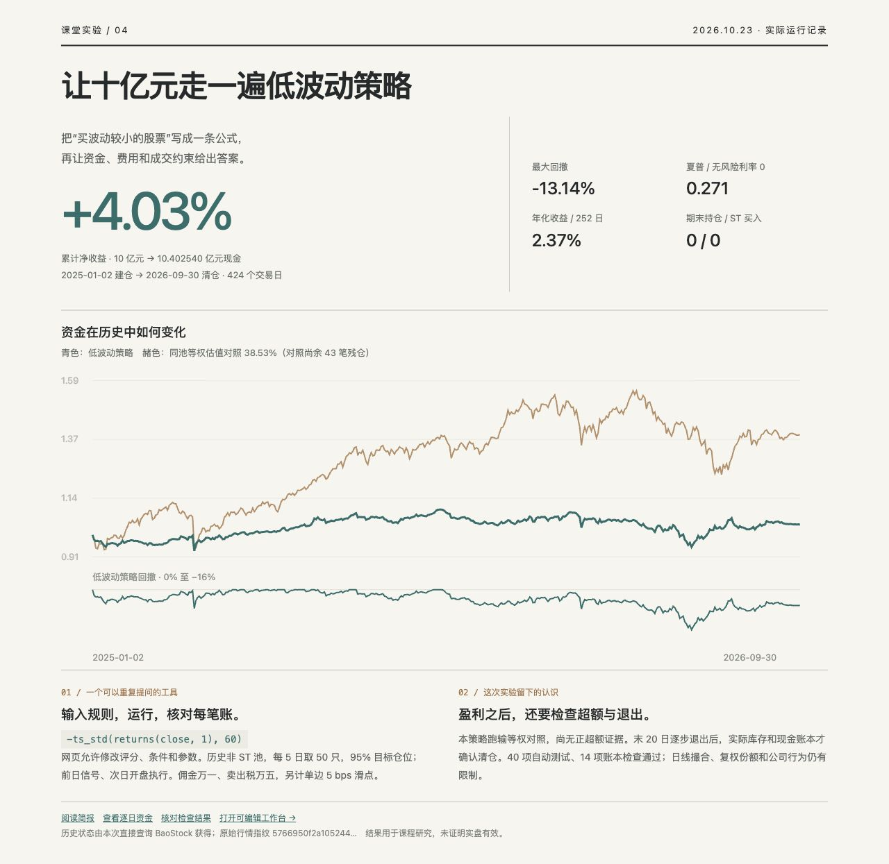
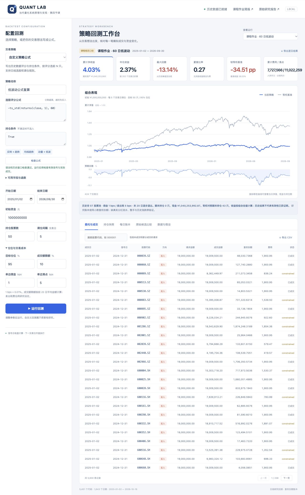

# 把交易想法写进网页：十亿元低波动实验

更新：2026-10-23。来源：[课程要求与数据](https://github.com/aslan9/pku_quantllm/issues/8)、[实际汇总](summary.json)、[账本检查](checks.json)。

这次我检验的直觉是：优先买入过去波动较小的股票，能否在控制回撤的同时获得较好的收益？我把这个想法做成可重复运行的网页：输入选股评分与条件，设置资金和交易成本，运行后查看净值、回撤、每笔成交及现金账本，也可以导出 CSV。

按老师要求采用 **10 亿元**初始资金，**2025-01-02 首日开盘开始建仓，至 2026-09-30，共 424 个交易日**；买卖佣金各万一，卖出印花税万五，另加单边 5 bps 滑点。信号仅使用前一日收盘及以前数据。历史 ST/*ST、停牌按逐日状态筛选，未知状态不新增买入；原包没有 ST 字段，不能用当前股票名称替代历史状态。

网页中的表达式是 `-ts_std(returns(close, 1), 60)`。其中 `returns` 计算复权日收益，`ts_std` 计算过去 60 日波动，负号使波动较小的股票排名靠前。每 5 日取前 50 只等权，目标仓位 95%。这个评分沿用此前用 2023–2024 年验证数据从 18 个候选中选出的结果；原始方案、候选和失败结论均保留在仓库，没有按本期收益重新挑赢家。

行情来自课程 7 份 Feather（1,643 日 × 5,451 只证券）。可投池还要求至少 120 个有效观察、近 20 日连续有效、股价≥2 元、20 日均成交额≥2,000 万元。每只每日成交额上限为前 20 日均额的 10%；4.8% 方向跳空保护是额外的日线近似。为满足结束日离场，末 20 日逐步降低目标仓位、不再买入，卖出仍受原有约束。

**10 亿元最后变为 10.402540 亿元现金。**累计净收益 **4.03%**，年化 **2.37%**，最大回撤 **-13.14%**，夏普 **0.271**。首笔成交发生在 2025-01-02，期末股票为 **0 只**，ST 买入成交为 **0**。佣金及印花税合计 772.76 万元，滑点成本 1,102.23 万元；滑点已计入成交价。平均实际仓位 88.59%，年化按 252 日、无风险利率按 0 计算。

这次最值得保留的发现有两点。第一，**赚到钱并不等于选股有效**：同池等权估值收益为 38.53%，低波动落后 34.51 个百分点。这个等权组合是自建对照，期末尚有 43 笔、约 575.62 万元残仓，其收益仍含未变现估值。第二，**目标仓位降到零与实际卖完是两回事**：检查中发现末几日才退出会留下残仓，因而把退出安排提前到 20 日，最后通过成交和现金账本核对清仓。这个修订是在查看结果后完成的，不能把修订后的表现称为全新独立样本外证据。

本次运行有 40 项自动测试、14 项账本检查通过。历史 ST 状态由 [fetch_status.py](../fetch_status.py) 直接查询 BaoStock 的 `isST` 和 `tradestatus`，共请求 5,273 只证券、取得 2,305,401 条记录，查询错误为 0；本区间有价格单元的状态覆盖率 100.00%。[状态说明](status-source.json) 保存接口、时间和哈希。原始行情及状态宽表不重复上传。

采用小数复权份额而非真实整手，缺完整分红到账与涨跌停盘口；每日状态和复权因子在开盘可用、日线有效价格可成交均为研究假设。补充海通证券、中国重工换股事件，等权账本实际触发；[海通新增股上市公告](https://www.hkexnews.hk/listedco/listconews/sehk/2025/0313/2025031301549_c.pdf)、[中国船舶公告](https://static.cninfo.com.cn/finalpage/2025-09-12/1224653316.PDF)。其他公司行为尚不完整，停牌期间沿用最后有效价格，未用估值归零伪造清仓。既有测试区间已被观察，本次不是全新独立样本外验证，更不代表实盘容量或盈利保证。

下面两张是实际网页截图：第一张是作业结果，第二张是可编辑策略。运行方法见 [系统说明](../README.md)。

[逐日资金](selected_daily.csv) · [逐单委托](selected_orders.csv.gz) · [持仓快照](selected_holdings.csv.gz) · [本次代码](../course.py) · [原始候选比较](../results/candidates.csv)。
