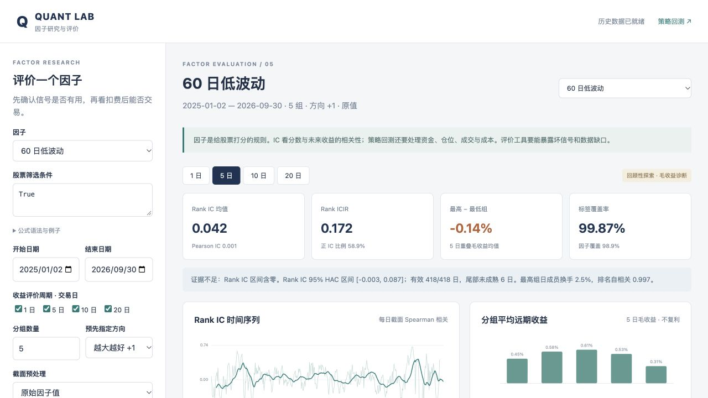

# 因子研究与评价实验台

更新日期：2026-10-29。状态：评价、有限候选挖掘和回测衔接可运行；独立作业报告保存在 `reports/lesson-05/`，系统不提供报告页面。

本课在[第四课系统](../lesson-04/README.md)上增加“先评价因子，再检查策略”的流程，复用数据读取、历史非 ST 池、安全公式和现金/成交账本。第五课代码与结果单独保存。老师引文及解释边界见 [Wiki 来源](../wiki/sources/factor-evaluation-lesson-05.md)。

## 使用

在仓库根目录运行，依赖沿用[第四课 requirements](../lesson-04/requirements.txt)，没有新增依赖：

```bash
python3 -m pip install -r lesson-04/requirements.txt
OPENBLAS_NUM_THREADS=1 OMP_NUM_THREADS=1 python3 lesson-05/app.py
```

打开[因子评价实验台](http://127.0.0.1:8768/)。[策略回测页](http://127.0.0.1:8768/backtest)保留第四课的参数配置、净值、订单、持仓和导出。服务仅监听本机。

默认只读使用本地 `lesson-04/data/feathers.zip` 和 `lesson-04/data/status.parquet`，这些文件不入 Git，准备方法见[第四课说明](../lesson-04/README.md)。可传 `--data /path/to/feathers.zip --status /path/to/status.parquet --port 8768`。没有状态表时使用研究池，页面会提示，不能声称剔除了历史 ST。ZIP 哈希必须与第四课审计一致。

作业分析、图表与结论单独保存在 [GitHub 报告目录](../reports/lesson-05/README.md)。系统只提供研究与回测功能；2026-10-23 的[历史评价记录](../reports/lesson-05/evaluation-20261023.md)和HTML快照已移到报告目录归档。



## 完成的功能

| 功能 | 输出与用途 |
| --- | --- |
| 18 个既有因子、自定义公式、筛选条件与预先指定方向 | 复用第四课 AST 白名单，拒绝未来窗口与任意 Python |
| 原值或逐日截面 1%/99% 缩尾后 z-score | 只使用当日可投截面，不用全时期均值/方差 |
| 1/5/10/20 日 IC、Rank IC、ICIR、正 IC 比例与 HAC 区间 | 衡量相关方向及稳定性；API 可设置 1–60 日周期 |
| 信号日分组、各组毛收益、高减低组、组均值单调性 | 分组先于标签配对，缺失标签不改变成员 |
| 因子覆盖、标签覆盖、各组形成/配对样本和尾部成熟状态 | 分开披露因子缺失与未来收益缺失 |
| 最高/最低组日成员换手、相邻日排名自相关 | 观察稳定性及成本压力，不替代成交账本换手 |
| 月度/年度分段与全部候选同口径比较 | 保留时变及负结果，不自动反转方向或挑选时期 |
| 常数、固定种子随机、低波动反向对照 | 检查无效输入、随机噪声和方向对称性 |
| 网页公式编辑、周期切换、CSV 导出、会话运行切换 | 新运行保存于忽略目录 `runtime/`，不覆盖固定结果 |
| 同因子衔接扣费策略回测 | 保留评分、条件、方向和预处理，调用原资金/费用/容量引擎 |

## 计算口径

本项目将 **IC** 定义为 Pearson 相关，**Rank IC** 为 Spearman 相关；[Alphalens 文档](https://quantopian.github.io/alphalens/alphalens.html#alphalens.performance.factor_information_coefficient)把 Spearman 直接叫作 IC，比较时须先核对定义。ICIR 使用 Rank IC 均值除以样本标准差，**不年化**；标准差为零时不可计算，不制造无穷值。

所有日期是交易日序号。信号在 t 收盘后形成，h 日标签为：

```text
复权开盘价[t+1+h] / 复权开盘价[t+1] - 1
```

评价开始/结束指**信号日范围**，且退出日不超过结束日。最后 h+1 个信号日没有完整标签，不计入标签覆盖率分母。开仓/退出价格非正或缺失则标签为空，不前填、不跨股票转换。未来价格只构造标签，不参与信号和入池。

分组按当日有限分数的平均秩百分位确定，同值保持同组。独特分值不足或不能形成完整组数时，当日分组无效。Q1 最低、Q5 最高（组数可调）。每组先对当日有效标签等权平均，再对日期平均；高减低组也是逐日差的均值。**这是诊断毛收益，缺失样本仍可能导致偏差，不是可成交的做空组合。重叠 h 日收益从不直接连乘成净值。**

95% 区间采用原日期网格的 Bartlett HAC，滞后阶 `max(5,h)`；至少 30 个有限日才提供区间，日期空缺不压缩。该近似只考虑有限阶相关，没有多重比较校正，也未解决长期相关和非平稳问题。诊断中的覆盖门槛 80%/95%、有效日 60、区间下限及分组差判据是**教学设置**，不是教师评分标准或通用投资门槛。

策略回测沿用第四课的**成交日范围**：首日使用上一交易日评分，末 20 个交易日渐进退出。默认 10 亿元、前 50 名、每 5 日调仓、95% 目标仓位、佣金单边 1 bps、卖出税 5 bps、滑点单边 5 bps（沿用第四课成本假设，不代表完整市场费率）。因此回测净值与分组 h 日收益的持仓、日期及成本不同。可在策略页调整参数重新运行；该页再次运行采用其表单内容，不自动保留第五课预处理扩展。

## 复现与文件

```bash
OPENBLAS_NUM_THREADS=1 OMP_NUM_THREADS=1 python3 -m pytest -q lesson-04/tests lesson-05/tests
OPENBLAS_NUM_THREADS=1 OMP_NUM_THREADS=1 python3 lesson-05/run.py
```

批量命令生成 [21 个候选/对照 × 4 个周期](results/comparison.csv)、各自 `results/factors/<name>/` 下的 `settings.json / summary.csv / daily.csv.gz / periods.csv / quantiles.csv`及[运行记录](results/run.json)。传 `--output lesson-05/runtime/reproduction/results` 可另存。`daily.csv.gz` 可由 `pandas.read_csv` 直接读取，网页导出普通 CSV。

核心实现：[factor.py](factor.py)、[shared.py](shared.py)、[app.py](app.py)、[run.py](run.py)、[测试](tests/test_factor.py)、[计算方案](protocol.json)、[验收记录](results/checks.json)。第四课服务仅提取可覆写的评分方法，原行为由既有测试及实数据账本等价检查覆盖。

## 证据边界

本次沿用已查看的 2025-01-02 至 2026-09-30 历史，统一称回顾性探索，没有新增独立测试期。缺行业/市值，不能声称已中性化或发现独立 Alpha。端点收益忽略停牌期间退出可行性、跨证券换股、真实分红到账与开盘深度；缺失标签不是零损失或已卖出。历史状态发布时间、完整退市覆盖、交易约束仍有第四课所述限制。工程通过不意味着可盈利或可部署。

## 因子分析与挖掘

[本轮固定方案](mining-protocol.json)列出12个新增公式，与18个既有因子作开发/筛选/后续三段比较，主指标为5日Rank IC；保留全部结果，不按2026表现重新选择。提供相关矩阵、股价/成交额/波动率代理控制、10亿元与100万元资金敏感性、成本压力及同条件等权对照。

```bash
OPENBLAS_NUM_THREADS=1 OMP_NUM_THREADS=1 python3 lesson-05/mining.py
OPENBLAS_NUM_THREADS=1 OMP_NUM_THREADS=1 python3 lesson-05/verify_mining.py
MPLCONFIGDIR=/tmp/lesson05-mpl python3 lesson-05/mining_report.py
```

结果保存于 [research-20261029](research-20261029/)，报告与PNG/SVG图保存于 [reports/lesson-05](../reports/lesson-05/)。等权基准的重复逐单/持仓约90MB留在本地，不上传Git；其逐日账本、配置和重建代码公开。新公式可粘贴到网页自定义因子输入框。66项自动化测试通过；本轮24项标签/账本核对通过。BY/HAC的第三方数值交叉核对只用于验收，不增加系统运行依赖。
