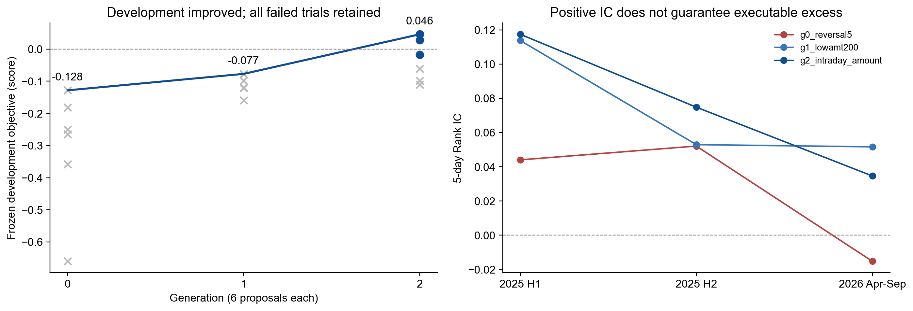
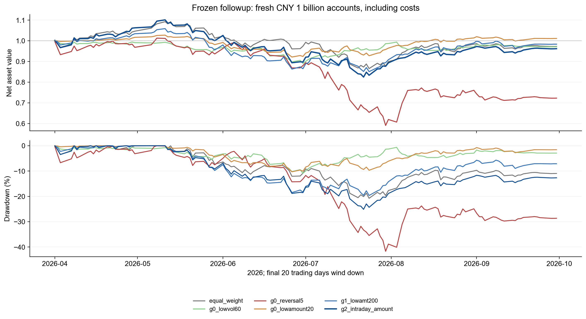
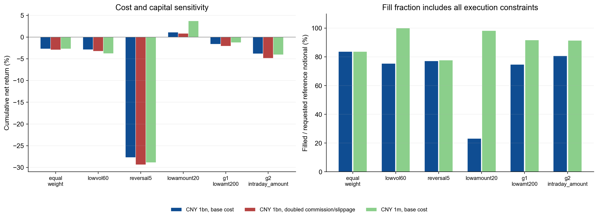

# 第六次作业：Agent 驱动因子与策略演化

更新日期：2026-10-30。状态：完成3代18个候选、冻结筛选、18组后续场景账本与结果核对；未证明可部署 Alpha。来源为本次作业指令、课程原始数据及[实际运行记录](../../lesson-06/results/summary.json)。

本次完成了“Agent提出假设→Harness调用评价/回测→反馈→因子变异与策略修改→淘汰/保留→冻结”的闭环。最后一代有3个候选通过开发门槛，筛选选出 **日内反转与低成交额**；但它在2026年4–9月净收益 **-3.81%**，同条件等权 **-2.71%**，相差 **-1.10 个百分点**。开发期目标改善没有延续为后续正超额。

## 1. 实现了什么，Agent究竟在哪里

复用第四课安全公式、动态证券池及显式现金/复权份额模拟账本，复用第五课IC和分组评价。本次代码独立放在 [lesson-06](../../lesson-06/README.md)，报告与图独立存放，旧作业结果不覆盖。公式在t收盘形成，次日开盘后才可能交易；5日评价标签为 `adjusted_open[t+6] / adjusted_open[t+1] - 1`，退出日不得越过该阶段终点。

Agent是**当前Codex会话**，不是预先写好的变异规则：先评价6个祖先，读取其两折结果后撰写6个子代，再根据第二代反馈提出最后6个子代。每个提案有经济假设、父代、改动理由及反馈指纹。因子演化修改窗口、日内分解或信号组合；策略演化修改持仓数、调仓间隔或流动性条件。所有失败候选保留。

Harness只接受白名单JSON和历史表达式，负责固定预算、去重、运行工具、记录结果、排序和停止。`auto --agent-command`可让可信的外部模型命令独立循环；该接口已用明确标注的模拟Agent完成全流程测试，本次未配置额外模型服务或宣称调用了独立API。自述Agent名称和内容哈希可以核对文件一致性，不能替代外部认证的模型调用凭证或文件系统隔离。

原始会话提案、上下文、反馈与当时源码保存在[会话证据](../../lesson-06/provenance/interactive-session/)。审核后修复了自定义候选ID、保留ID、输入类型和空成交CSV的接口边界；**最终 results 是最终代码对原提案的明确标注重放**。原始会话与最终重放的18个候选及开发指标完全一致，原假设、筛选规则和已选策略未根据后续结果修改。重放不算第二次独立发现。

## 2. 时间、资金与冻结规则

| 阶段 | 日期 | 可以影响什么 |
| --- | --- | --- |
| 演化两折 | 2025-01-02至06-30；2025-07-01至12-31 | 提案、子代和开发排序 |
| 冻结筛选 | 2026-01-01至03-31 | 仅在开发冻结的前三中一次性选择 |
| 后续检查 | 2026-04-01至09-30，共125个交易日 | 只评价预先冻结的候选与对照，不再改模型 |

历史ST状态表从2024-12起，因此没有对缺少状态的2023–2024年冒称完成相同过滤。上述历史在第四、五课已可见，**全部属于回顾性演化，时间切分不恢复独立未见测试**。每折/阶段新开账户，末20日逐步退出，不能拼接成连续资金业绩。短筛选期受行情与退出安排影响很大。

每个账户初始10亿元，目标95%仓位；候选持仓50/100/200只，调仓间隔5/10/20个交易日。成本沿用课程假设：佣金单边1bps、滑点单边5bps、卖出税5bps；前一日已知20日成交额的10%为容量上限。动态等权对照也使用相同资金、证券池、成本和约束，固定5日调仓。该对照检验整个策略变化，不是单独识别调仓频率的因果效应。

开发目标为“两折年化算术净超额中的较小值 − 0.25×最差回撤绝对值 − 0.0001×AST节点数”。年化算术超额是同日策略与等权日收益差的均值×252；目标分数本身不是收益率。每折还要求Rank IC、Q5−Q1毛收益及算术超额均正，因子覆盖≥80%、标签覆盖≥95%、筛选池覆盖≥20%。这些是事前教学门槛，没有给自适应搜索提供显著性保证。完整设置见[协议](../../lesson-06/protocol.json)。

## 3. 怎样从反馈中进化

第一代：5日反转的IC两折都为正，但扣费算术超额均负、年单边换手约34/39倍。低成交额因子IC更强，成交比例却只有21%/26%。低波动虽然回撤低，分组差及超额不支持；60日动量方向亦不支持。6个祖先无一通过开发门槛。

第二代：优先修复组合与容量。低成交额从50只/5日改为200只/10日，成交比例升至68%/81%，开发目标改善约0.105，但下半年超额仍负。反转扩大持仓、降低频率和增加流动性门槛，也未同时通过两折。换手下降并不保证超额改善。

第三代：组合低成交额与反转，或对低成交额加入适度流动性下限。最后日内反转与低成交额在200只、10日调仓下，两折年化算术超额分别为18.29%/8.35%；第三代另两个通过者是低成交额加下限、低成交额加十日反转。单纯延长到20日调仓、十日反转十日调仓等分支仍失败，未删除。

选定公式为 `rank(-ts_mean(close / open - 1, 5)) + rank(-ts_mean(amount, 20))`，即把过去5日日内跌幅与20日平均成交额的反向截面排名相加，优先持有得分最高的200只，每10个交易日调仓。它是本次测试的组合表达式，不声称学术首创；低成交额仍可能代理未观测的规模或行业暴露。

| 候选 | 代 | 持仓/间隔 | 两折 Rank IC | 两折年化算术超额 | 目标分数 | 开发门槛 |
| --- | --- | --- | --- | --- | --- | --- |
| g0_lowvol60 | 0 | 50/5 | 0.032/0.052 | -23.19%/-24.77% | -0.265 | 未通过 |
| g0_reversal5 | 0 | 50/5 | 0.044/0.052 | -4.69%/-6.52% | -0.128 | 未通过 |
| g0_lowamount20 | 0 | 50/5 | 0.114/0.053 | -3.46%/-16.71% | -0.182 | 未通过 |
| g0_rev_lowvol | 0 | 50/5 | 0.049/0.069 | -30.01%/-33.58% | -0.358 | 未通过 |
| g0_intraday20 | 0 | 50/5 | 0.101/0.066 | 0.22%/-19.52% | -0.250 | 未通过 |
| g0_momentum60 | 0 | 50/5 | -0.073/-0.069 | -57.14%/-28.95% | -0.660 | 未通过 |
| g1_rev200_5 | 1 | 200/5 | 0.044/0.052 | 0.72%/-6.00% | -0.120 | 未通过 |
| g1_rev100_10 | 1 | 100/10 | 0.044/0.052 | -6.39%/21.62% | -0.121 | 未通过 |
| g1_rev10_200 | 1 | 200/5 | 0.049/0.066 | 1.48%/-2.09% | -0.079 | 未通过 |
| g1_liquid_rev | 1 | 100/5 | 0.053/0.059 | -1.30%/-9.56% | -0.159 | 未通过 |
| g1_lowamt200 | 1 | 200/10 | 0.114/0.053 | 24.15%/-4.56% | -0.077 | 未通过 |
| g1_intraday5 | 1 | 200/5 | 0.056/0.058 | 2.80%/-4.06% | -0.099 | 未通过 |
| g2_amount_floor | 2 | 200/10 | 0.088/0.045 | 22.24%/6.21% | 0.028 | 通过 |
| g2_amount_slow | 2 | 200/20 | 0.114/0.053 | 16.26%/-8.04% | -0.111 | 未通过 |
| g2_amount_rev10 | 2 | 200/10 | 0.125/0.075 | 23.17%/2.21% | -0.018 | 通过 |
| g2_amount60 | 2 | 200/10 | 0.091/0.037 | 25.87%/-2.90% | -0.062 | 未通过 |
| g2_rev10_slow | 2 | 200/10 | 0.049/0.066 | -4.18%/17.04% | -0.098 | 未通过 |
| g2_intraday_amount | 2 | 200/10 | 0.117/0.075 | 18.29%/8.35% | 0.046 | 通过 |

以上数字是原始指标，未按自身最大值归一化。总计18个策略基因组，不等于18个全新独立因子；其中包括同因子不同持仓参数。完整公式、筛选条件、父代见[候选附表](candidates.md)，原始[提案](../../lesson-06/proposals/)含逐条理由。多项子代同时更改公式与持仓规则时，不能据此归因于某个单一部件。

## 4. 冻结后：一季度通过，随后未延续

先保存[冻结记录](../../lesson-06/results/freeze.json)，再运行以下三个筛选候选；[选择记录](../../lesson-06/results/selection.json)落盘后才计算后续阶段。

| 冻结候选 | 净收益 | 相对等权 pp | Rank IC | 筛选目标 | 通过 |
| --- | --- | --- | --- | --- | --- |
| 日内反转与低成交额 | 7.19% | 2.39 | 0.086 | 0.079 | True |
| 低成交额200只加流动性下限 | 5.09% | 0.29 | 0.081 | -0.007 | True |
| 低成交额与十日反转 | 6.53% | 1.72 | 0.100 | 0.050 | True |

日内反转与低成交额筛选期收益为7.19%，高于等权2.39个百分点，因而按冻结规则获选。这里“通过”只指预定教学门槛；不是统计显著或投资部署资格。随后所有比较共用2026年4–9月这一个窗口：

| 组合 | 净收益 | 相对等权 pp | 最大回撤 | Rank IC | 成交比例 | 期末持仓 |
| --- | --- | --- | --- | --- | --- | --- |
| 同条件动态等权 | -2.71% | 0.00 | -20.76% | — | 83.63% | 37 |
| 60日低波动 | -2.90% | -0.19 | -10.91% | 0.030 | 75.34% | 0 |
| 5日反转 | -27.73% | -25.02 | -41.70% | -0.015 | 77.17% | 1 |
| 20日低成交额 | 1.13% | 3.84 | -10.30% | 0.052 | 23.12% | 0 |
| 低成交额200只十日调仓 | -1.63% | 1.07 | -19.65% | 0.052 | 74.78% | 1 |
| 日内反转与低成交额 | -3.81% | -1.10 | -25.12% | 0.035 | 80.71% | 1 |

后续所选组合仍有正Rank IC（0.035），却落后等权且最大回撤为-25.12%。这再次说明全截面相关、Q5诊断毛收益、实际只做多前200名和现金账本属于不同对象。反转祖先后来Rank IC转负，净收益大幅下降，是明显的阶段敏感性。原始低成交额50只在这段反而优于演化组合，但它不是事前筛选赢家；不能在看过后续收益后把它改称本次选择结果。

所选策略与等权配对日收益差的20日移动块自助法、1000次、固定种子，年化**算术平均超额**95%名义区间为 **[-30.29%, 27.32%]**，包含零。它不是累计收益差或CAGR区间，也没有校正18次自适应尝试、短窗口、长期依赖及历史重复查看。区间不能证明正超额。

## 5. 成本、资金与未完全退出

| 组合 | 十亿元 | 佣金/滑点加倍 | 百万元 | 十亿元/百万元成交比例 |
| --- | --- | --- | --- | --- |
| 同条件动态等权 | -2.71% | -2.95% | -2.71% | 83.63%/83.63% |
| 60日低波动 | -2.90% | -3.25% | -3.80% | 75.34%/100.00% |
| 5日反转 | -27.73% | -29.36% | -28.88% | 77.17%/77.74% |
| 20日低成交额 | 1.13% | 0.84% | 3.71% | 23.12%/98.29% |
| 低成交额200只十日调仓 | -1.63% | -2.10% | -1.28% | 74.78%/91.70% |
| 日内反转与低成交额 | -3.81% | -4.85% | -4.07% | 80.71%/91.47% |

所选策略加倍佣金/滑点后净收益降至-4.85%；降至百万元也没有恢复正收益。后续年单边换手约18.04倍。低成交额50只在十亿元下成交比例约23%，百万元约98%，说明容量约束会改变持仓与路径；该比率同时包含现金和开盘门禁影响，不能单独归因于盘口容量。

期末等权仍有37只、所选策略仍有1只持仓，退出受阻时按沿用引擎的标记价格估值；**收益是期末估值收益，不是已全部变现**。沿用复权份额/合成总回报账本、日线零成交额停牌代理、统一开盘门禁和不完整公司行为；缺少行业、时点市值、精确状态发布时间、完整退市损失和开盘深度，不能声称中性化、独立Alpha或真实可成交保证。

## 6. 本次结果支持什么

1. 工程上，Agent能读取反馈并提出有父子关系的因子与策略变更，Harness能执行、淘汰、保留完整尝试并冻结。开发目标从-0.128改善至0.046，证明本轮实现了反馈循环。
2. 投资效果上，没有获得可持续正超额的证据。所选组合在后续落后等权，区间含零；更复杂的组合后来也没有胜过更简单的低成交额祖先。开发目标提升可以伴随后续失效。
3. 本次没有随机搜索、固定网格或多次LLM种子对照，不能声称Agent优于这些搜索方法；也没有新未来数据。这里的“进化”是提案和筛选过程，不是盈利随代数单调提高。

下一步应先锁定本次完整流程，在新增且未查看的数据上检验；同时补齐时点行业/市值及执行约束，再用同预算的随机/固定搜索重复比较。若要解释改善来自哪里，另设同公式不同持仓、同持仓不同公式的配对实验；本次结果本身不能替代这些验证。

## 复现与证据

运行方法见[系统说明](../../lesson-06/README.md)。最终代码重放与原会话开发历史逐值一致；独立核对212项通过。订单CSV以12位有效数字保存，重建现金最大误差0.00687元、权益最大误差0.00785元；独立抽样标签/Rank IC最大误差4.8e-11。核对范围及浮点容差见[verification.json](../../lesson-06/results/verification.json)与[核对代码](../../lesson-06/verify.py)。

数据/源码[指纹](../../lesson-06/results/manifest.json)、全部[后续指标](../../lesson-06/results/followup.csv)、[逐日/逐单/持仓](../../lesson-06/results/backtests/)、[原会话证据](../../lesson-06/provenance/interactive-session/)均可追踪。等权重复大体量订单/持仓留本地、不入Git，逐日账本与重建代码保留。源码测试与账本检查不证明所有市场假设正确；只读审核为同模型家族的暂定意见，见[审核记录](EXPERIMENT_AUDIT.md)。

方法参考（2026-10-30查阅）：[Microsoft RD-Agent反馈循环](https://www.microsoft.com/en-us/research/articles/rd-agent-an-open-source-solution-for-smarter-rd/)、[Alphalens相关性定义](https://quantopian.github.io/alphalens/alphalens.html#alphalens.performance.factor_information_coefficient)、[Bailey等回测过拟合](https://www.davidhbailey.com/dhbpapers/backtest-prob.pdf)。本课为自身系统上的实现，不引用其他框架的实验绩效为本课结果。

后续系统集成：已将演化页面、候选/父代/反馈与一键复测接入原回测服务；实际策略及基准逐日权益差异均0元。界面与93项测试等验收证据见[集成记录](integration/README.md)。报告的投资有效性结论不因此改变。
