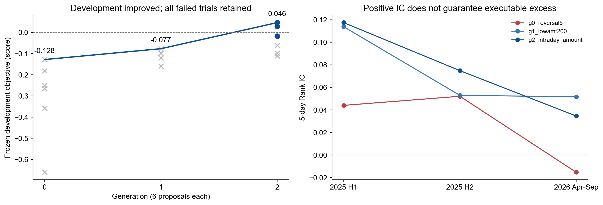
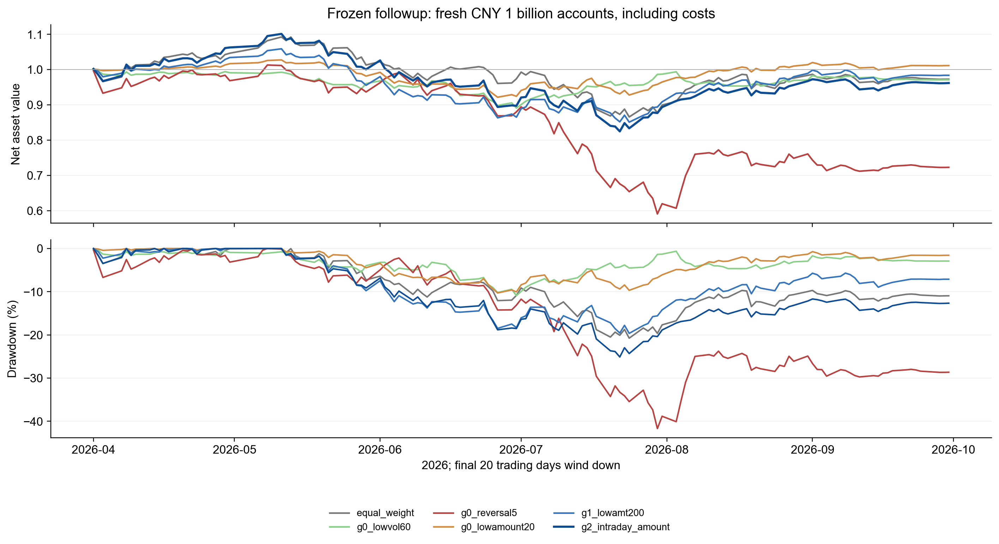

# 第六次作业：Agent 驱动的因子与策略演化

整理日期：2026-11-06；实验与系统验收日期：2026-10-30。

在原回测系统上实现了因子挖掘 **Agent Harness**，形成“提出假设 → 因子评价与扣费回测 → 反馈 → 修改公式和策略 → 筛选、冻结”的闭环。功能已接入原网页，可查看候选、父代和修改理由，并一键送入策略回测；93项测试通过，所选策略及基准的复测权益与保存结果逐日一致。

本轮由Codex会话读取每代反馈并生成下一代提案，完成 **3代、18个因子/策略候选**。最终代码重放用于数值核对；网页重放不产生新假设，另接模型的自主挖掘接口需配置模型命令。

初代测试反转、低波动、低成交额等种子；第二代针对换手和成交约束扩大持仓、调整调仓频率；第三代尝试组合信号及增加流动性下限。逐代领先者的开发目标分数从 **−0.128 → −0.077 → 0.046**，最后3个候选通过预设开发门槛。该分数综合净超额、回撤和复杂度，不是收益率。



*图1：横轴0/1/2对应第1/2/3代；右图说明开发期的正相关可能在后续减弱。*

冻结筛选选出“**日内反转＋低成交额**”：将过去5日日内跌幅和20日平均成交额的反向排名相加，持有前200只，每10个交易日调仓。

```text
rank(-ts_mean(close / open - 1, 5)) + rank(-ts_mean(amount, 20))
```

2025年上下半年用于开发演化，2026年一季度筛选，4—9月作冻结后的检查。回测沿用历史非ST池，初始10亿元、目标95%仓位，佣金单边1bps、滑点单边5bps、卖出税5bps，并保留原容量约束；等权基准固定5日调仓。以下均为2026年4—9月同条件扣费结果：

| 组合 | 净收益 | 最大回撤 |
| --- | ---: | ---: |
| 同条件动态等权 | −2.71% | −20.76% |
| 第1代领先者：5日反转 | −27.73% | −41.70% |
| 第2代领先者：低成交额200只 | −1.63% | −19.65% |
| 第3代／最终选定：日内反转＋低成交额 | **−3.81%** | **−25.12%** |



*图2：g0_reversal5、g1_lowamt200、g2_intraday_amount分别对应表中三代领先者；灰线为等权基准，另保留两个简单因子对照。*

本次完成了Agent反馈驱动的因子、策略演化与网页集成，但开发成绩改善没有延续为后续正超额。最终组合仍落后等权 **1.10个百分点**，说明正IC和更复杂的信号组合不能保证实际净收益更高。历史此前已被查看，本次属于回顾性研究；期末仍有残仓，收益按组合估值计算，不能据此认定可部署Alpha。

来源与复现：[系统及启动说明](../../lesson-06/README.md) · [完整结果分析](README.md) · [原系统界面与集成验收](integration/README.md) · [原始结果](../../lesson-06/results/followup.csv)。
