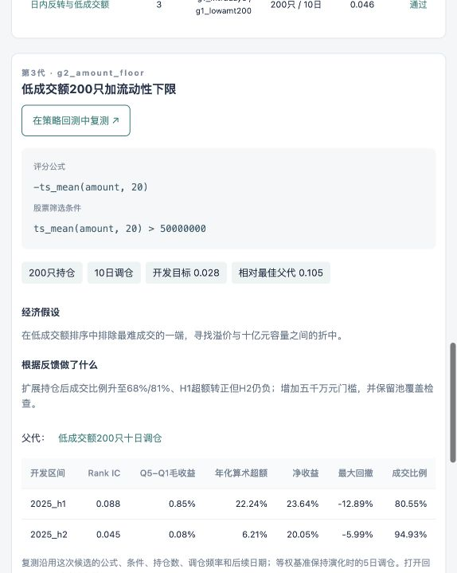
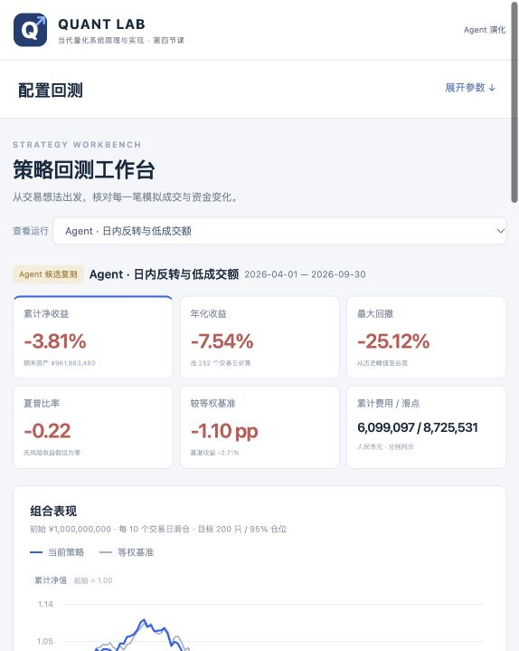

# 第六课与原回测系统的网页集成验收

更新日期：2026-10-30。状态：完成原服务集成与实际浏览器/账本核对。来源：[网页控制器](../../../lesson-06/evolution_web.py)、[自动测试](../../../lesson-06/tests/test_evolution_web.py)和[实数据检查](checks.json)。

第一版第六课只有底层复用和命令行Harness。用户指出应整合到此前开发的回测系统后，补上同一服务的 `/evolution` 页面；第四课原服务与第五课统一服务均可进入，无需新启第六课服务。系统继续只提供研究/回测操作，分析报告留在独立目录。

实测通过：查看18个候选；按代筛选；点击不同候选显示其公式、条件、假设与反馈；查看父代；资金/成本场景；从候选一键进入原回测页。后端拒绝跨来源POST、未知候选、网页命令注入参数及未配置的模型自主模式，共享任务锁。新任务由后台调用原Harness，结果与原会话/重放区分，写入忽略目录。

实际复测所选 `g2_intraday_amount`，公式、条件、200只持仓、10日调仓、十亿元资金与后续日期均保持；基准保留原演化5日调仓。125日策略及基准权益与冻结结果**逐日完全一致，最大差异均0元**。原回测页显示净收益−3.81%、相对基准−1.10个百分点，并可继续编辑和导出。

第四、五、六课共93项自动测试通过，包括原入口、统一入口、候选参数与基准保留、后台控制器和服务重启的进程保护。JavaScript/Python语法与相对链接检查另行记录在维护日志。模型自主接口的集成测试使用明确标注的模拟命令；当前本地服务未配置额外模型连接，界面不会把重放包装成新挖掘。

上述是功能与账本一致性验证，不增加新的投资有效性证据；原[结果报告](../README.md)中的回顾性和后续失效结论不变。临时运行ID供本机核对，不是发布地址；输入行情、状态宽表、全部缓存和重复大体量订单不入Git。
