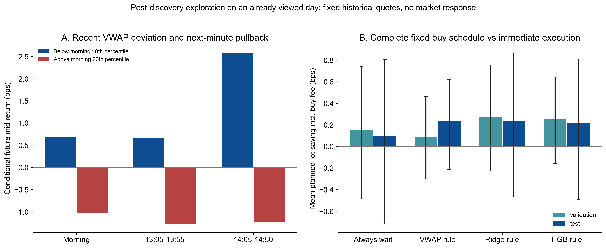

# 补充：反直觉发现与可研究的执行策略

更新日期：2026-10-09。状态：对已经查看过的单日数据做补充探索；不能把下面新提出的假设称为独立留出验证。原 103 个候选选择和结果没有改写。

来源：[原研究](README.md)、[补充代码](followup_checks.py)、[条件均值表](results/followup_vwap_extremes.csv)、[完整计划对照](results/followup_fixed_buy_plan.csv)。

## 价格相对近期成交均价的偏离，有分钟级回拉信息

过去 60 秒成交 VWAP 是成交额/成交股数。偏离 `g=(当前中间价/VWAP-1)*10000` 使用决策时点之前的信息。每只股票的低/高组边界由上午样本的第 10/90 分位确定。决策后延迟 5 秒，再观察未来 60 秒中间价变化。

| 观测时段 | 低偏离组下一分钟均值 | 高偏离组下一分钟均值 |
| --- | ---: | ---: |
| 上午 | +0.69 bps | −1.03 bps |
| 13:05–13:55 | +0.66 bps | −1.27 bps |
| 14:05–14:50 | +2.58 bps | −1.22 bps |

尾盘组样本数为 876 / 627。这些是密集、重叠样本的条件价格均值，不是独立交易回报。尾盘扣除同一时刻样本市场平均未来变化后，仍约 +2.59 / −1.17 bps；这一去市场描述也不建立因果关系。

值得提出的策略假设是：近期相对高价时减少追买，近期相对低价时提高必需买单的执行速度。它有观察到的方向一致性。中间价低于 VWAP 不保证能按这个低价买到；买入需面对卖盘，这解释了方向信息为何不等于套利收益。

## 买一厚，不一定在描述正在追涨

原始队列不平衡与过去 30 秒中间价变化的相关，在上午、午后、尾盘约 −0.178 / −0.207 / −0.237；与未来 60 秒的相关约 +0.039 / +0.030 / +0.069。原始相关与主报告训练归一化后的 IC 定义不同。

这与“刚下跌后，低价买盘出现承接或补单；之后价格较容易回稳”的解释相容。现有统计没有区分承接、队列机械更新、撤单等机制，不能认定原因。尾盘“过去 30 秒下跌且买一较厚”的组，未来绝对均值约 −0.001 bps，并非保证反弹；其相对同时间样本市场约 +0.164 bps。详细四组结果见 [条件表](results/followup_queue_conditions.csv)。

## 同期 OFI 很强，却可能没有可用的提前量

尾盘近似 OFI 与过去 30 秒变化相关约 0.658，与延后入场的未来一分钟约 0.0008。它容易解释已经发生的变化，不能直接变成未来交易规则。主动成交压力也不能只按“买得多就继续涨”解释，原表中其上午与午后的部分期限方向不稳定。

## 执行优化具体是什么

任务由“已经决定买入多少股、最晚何时完成”开始，而不是由方向预测决定新增投机交易。一个教学实验可设：已有买入 10,000 股需求，五分钟内完成，以固定数量/时点的 TWAP 为基准。总股数和截止时间必须一致。

| 决策 | 待检验规则 | 必须衡量的代价 |
| --- | --- | --- |
| 提前或等待 | 预计下一分钟上涨时加快买入；预计回落时有限等待 | 延迟后的价格、错过上涨、截止时赶单 |
| 挂单或主动成交 | 有时间、预期平稳时挂买一或价差内合法价位；上行风险高/接近截止时主动买 | 排队、成交率、部分成交、追加费用 |
| 挂单后保留或撤销 | 盘口/订单流提示成交后还会跌时，减少或撤销被动买单 | 撤单延迟、撤时成交、错过完成机会 |
| 子单大小 | 根据可见深度和成本控制每笔数量 | 吃多档、市场冲击、最低佣金和未成交量 |

这里最需要防止的现象是：被动买单上涨时不成交，下跌时容易成交，而成交后继续跌。成交率高和省了价差都不足以证明订单质量好，必须计算**成交条件下**的后续价格变化。订单流、队列与市场/限价单分配的研究依据见 [Cont、Kukanov 的订单放置研究](https://arxiv.org/abs/1210.1625)，它不证明本数据上的规则已有效。

## 我补做了一个完整计划，而非只挑极端预测

每只股票每两分钟固定计划买 1,000 股，决策后 5 秒为立即执行点，最迟再等 60 秒。在固定行情中，用十档 1,000 股 VWAP 估计立即或延迟的成交价，并计入同侧买入费用。所有计划订单进入分母；午后 1,250 笔、尾盘 1,100 笔，观察到的十档在比较点均够 1,000 股。比较不因未来价格有利才选择订单。

| 相对立即买入的规则 | 午后：平均每计划单节省 | 尾盘：平均每计划单节省 |
| --- | ---: | ---: |
| 全部等 60 秒 | +0.16 bps | +0.10 bps |
| 高于过去 VWAP 时等，其他立即买 | +0.09 bps | +0.23 bps |
| 冻结 Ridge 预测为负时等，其他立即买 | +0.27 bps | +0.23 bps |
| 冻结 HGB 预测为负时等，其他立即买 | +0.26 bps | +0.21 bps |

上述非基准规则的当日共享时钟块区间均包含 0。尤其 Ridge 尾盘平均每单约 +0.23 bps，但按实际买入名义额加权只约 **+0.014 bps，合计节省约 163 元**。因不同股票单价不同，平均每单改善不能直接乘整个成交金额。完整对照还保留了相对样本市场跑赢时等待的探索规则，见 [结果表](results/followup_fixed_buy_plan.csv) 与 [逐单报价对照](results/followup_fixed_buy_orders.csv)。

这比“只看极端预测买单改善 1.27 bps”更接近真实任务，也更明确地显示目前证据弱。它没有建模自己下单改变报价、真实接收时钟、网络延迟、挂单成交或冲击；不是已验证的完整父订单策略。

## 反事实的边界和下一项实验

当前能做的是固定历史行情，改变我们立即/延迟、主动/被动的行为，对照成本。无法从这一天观察直接推出“移除某笔大买单后市场会怎样”或“撤单造成了下跌”；改变参与者行为后的市场响应没有被观察到。

优先实验：**固定父订单目标与截止时间，用已有逐单回放比较 TWAP、VWAP 回拉调度、预测急缓，以及挂单后有截止兜底的策略**。验证必须包括全部计划量、未成交量、最终成交 VWAP、费用、成交后不利价格变化与赶单成本。挂单队列估计要提供保守/乐观边界，再用多个未参与设计的交易日检验。卖出场景需要明确可卖库存；本次补充先做固定买入需求。

复现本补充：`python3 week-03-task2/followup_checks.py`。本图另存 PNG、SVG、PDF，未改写原九页图集。
