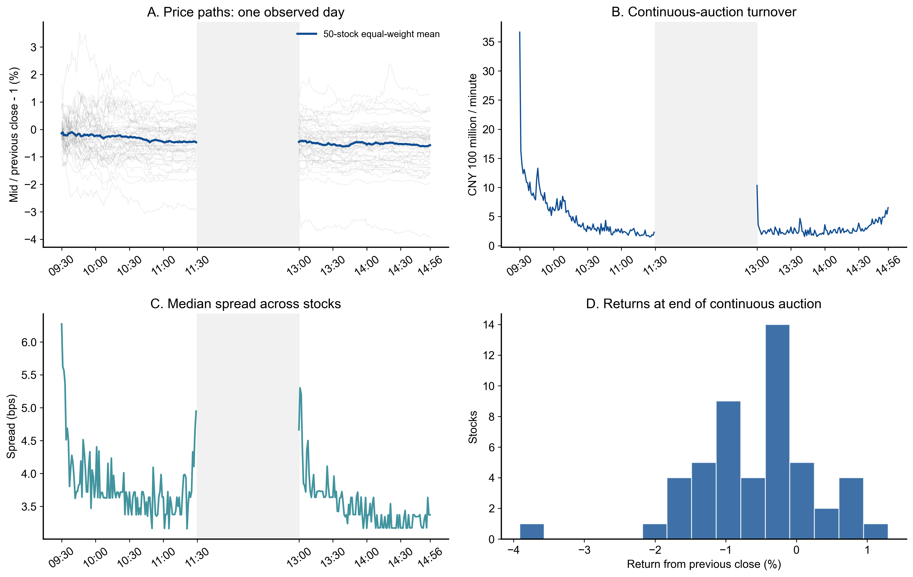
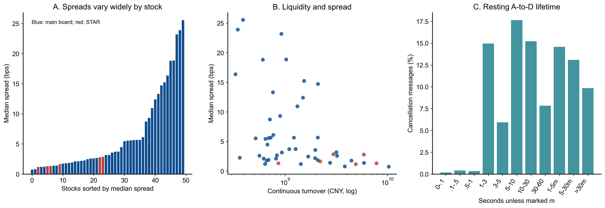
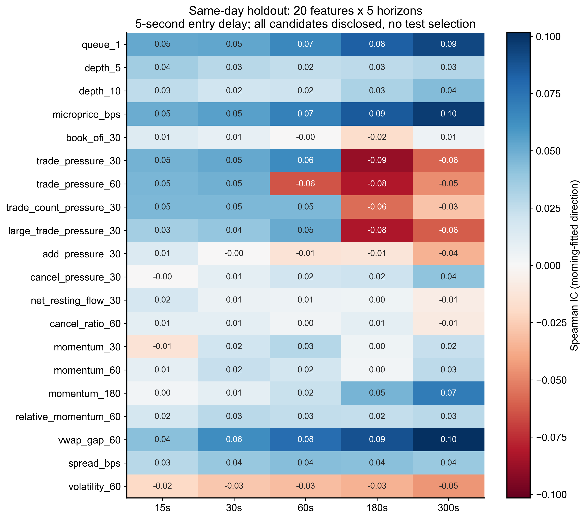
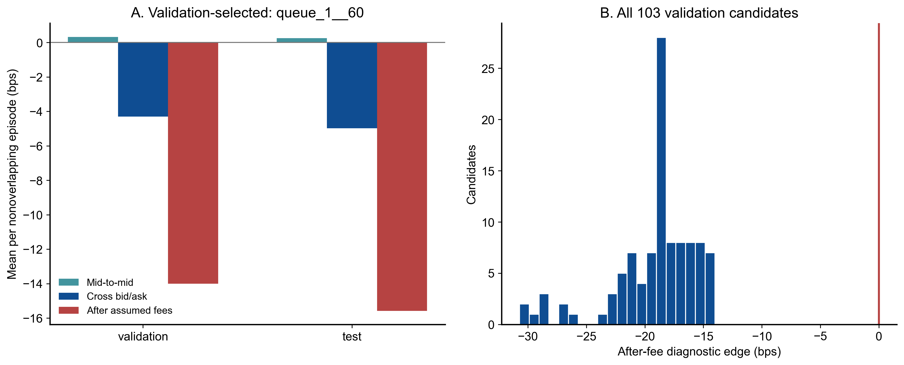
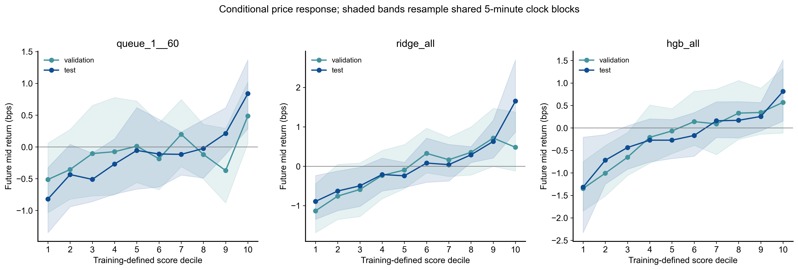
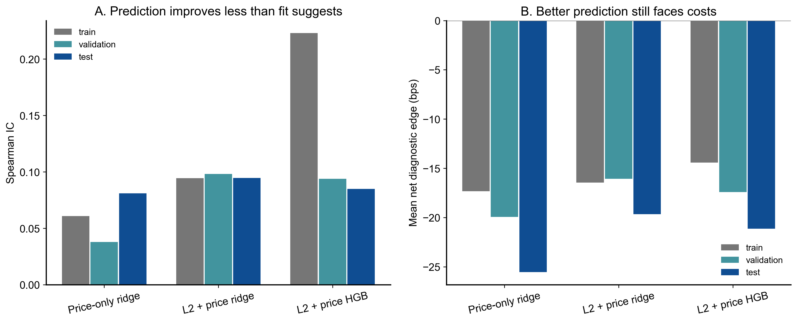
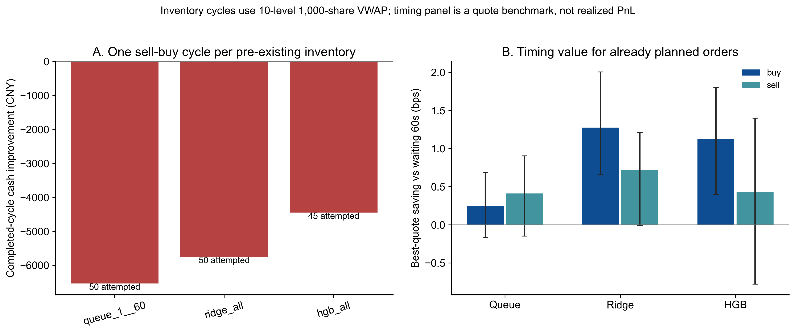
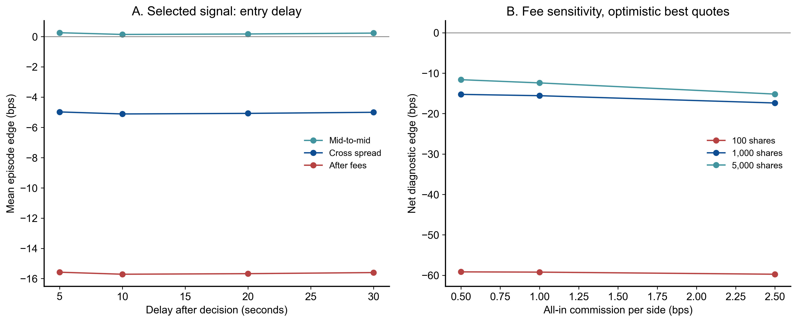
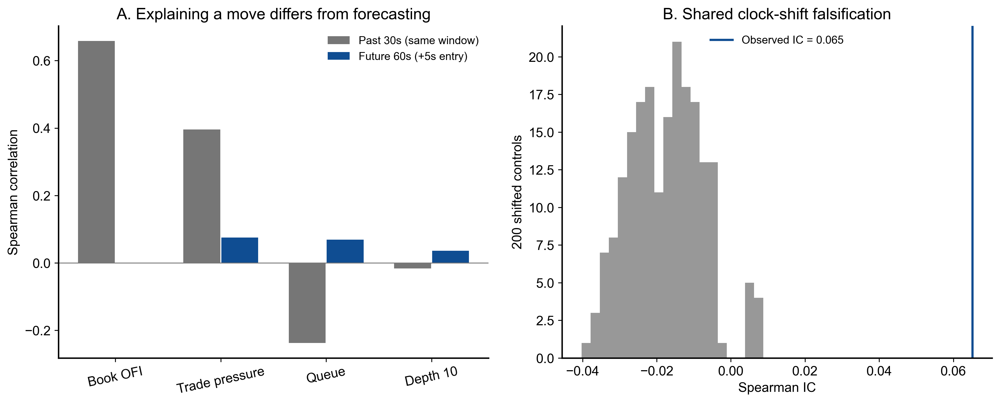

# 第三节实践课：数据挖掘（Level 2）

提交与发布整理日期：2026-10-16。研究目录保留为 `week-03-task2`。

更新日期：2026-10-16（Asia/Shanghai；研究结果形成于 2026-10-09）。状态：完整数据审计、103 个候选比较、同日时间留出、成本与底仓模拟、机制检查及可视化已完成；尚未获得跨日有效的盈利策略。作为第三节作业的 Task 2 单独记录，目录沿用第三周命名。

**结论：这批数据包含可测量的短期供需信息，但本次尝试没有找到扣除交易成本后合格的方向交易策略。更值得继续检验的用途，是流动性筛选和已有交易需求的执行时机优化。** 本报告明确列出失败结果，所有候选都保留在结果表中。

直接来源：用户提供的三份 Parquet，实际位于仓库旁的 `../第三周实践课/sse50_20260923`；本次只读，没有复制或修改原文件。供应商、采集/接收时间定义及转换协议未知。日期取自用户说明和文件名，没有独立证明该文件是完整交易所原始馈送。本次字段、来源指纹和核对结果见 [数据审计](results/data_audit.json)，证据来自本目录代码和保存结果。

原始数据不随研究目录上传；可从 [课程第三节实践课的数据 Release](https://github.com/aslan9/pku_quantllm/releases/tag/data-sse50-20260923) 获取三份同名文件，再按下方命令复现。

可先打开 [全部图表 PDF](figures/all-figures.pdf)，或下面九张图；完整数字见 [结果目录](results/)。图片使用英文坐标，避免不同机器的中文字体缺失，解释均为中文。

用户追问后的 [反直觉发现与执行策略补充](FOLLOWUP.md)：近期 VWAP 偏离的分钟回拉、厚买盘与过去/未来价格的不同关系，以及包含全部计划订单的立即/延迟对照。该补充是对已查看数据的探索，不改变原选模结论。

## 1. 数据是否足以用于研究

| 文件 | 含义 | 行数 |
| --- | --- | ---: |
| `ord_20260923.parquet` | 剩余委托新增、撤单和阶段标记 | 6,276,360 |
| `exe_20260923.parquet` | 逐笔成交 | 3,792,934 |
| `snp_20260923.parquet` | 十档行情快照 | 252,631 |

三份文件股票集合相同，共 50 只，含 6 只 `688` 股票。目录名 `sse50` 不足以证明它们是某一日期的官方上证 50 成分股。本研究使用代码标识，不推断行业、股票名称或指数权重。

本次直接核对：

- 三文件均无空单元格；成交价格与数量均为正；逐笔合并后的 `(Channel, BizIndex)` 无重复。
- 连续竞价共 3,751,604 条成交，主动方向 `B/S` 覆盖 100%，与买卖订单号中较新订单的方向一致率 100%。这个一致性检查支持方向解释，但不能替代供应商协议。
- 连续竞价快照 236,581 条，最优双边价格和数量均有效，无锁盘或交叉盘口。午间、开收盘集合竞价、盘后阶段没有混进连续竞价预测。
- 全部 50 只股票的竞价总成交股数与日终快照完全一致；逐笔按整数分累加的成交额，与快照整数元表示的差最大 49 分，符合金额舍入。盘后通道成交量另行核对，差为 0。
- 撤单均关联到此前同证券、同通道、同原始订单号的 A 消息，无负 A-to-D 时间。`OrderNumber` 全等于该条 `BizIndex`；订单关联使用 `OrderOriNo`。
- 连续竞价快照的毫秒尾数全部为 0，标注秒内的确切状态先后未知。本研究把快照可用时刻延后 1 秒，再把执行延后 5 秒，避免把同秒稍后状态当作已经看到。

委托新增 A 是**挂入的剩余数量**，可能已经先成交一部分，不能当作完整原始申报量。成交可能拆成多条 print；“大额成交”特征指大 print，不能据此判断机构订单或真实交易者身份。

[审计 JSON、字段、路径和 SHA-256](results/data_audit.json) · [逐股票日终核对](results/daily_reconciliation.csv) · [各阶段成交](results/trade_phases.csv)

## 2. 数据里的具体规律

### 2.1 当日成交集中在开盘，不能直接套用普遍的 U 型结论

连续竞价成交额合计约 **955.48 亿元**；前 15 分钟贡献 **19.80%**，连续竞价结束前 15 分钟贡献 **7.44%**。成交额最大的 5 只股票占 **36.43%**，样本横截面并不均匀。

50 只股票日终价格相对前收盘的等权平均变化约 **−0.61%**，范围约 **−3.81% 至 +1.33%**。这只是样本股票等权描述，不是官方指数收益，也不是一个可执行组合回报。

含义：交易强度和市场背景有时段差异。用上午拟合、午后验证，比随机打乱全部行更合理；某天开盘活跃也不能证明每天都有同样形状。



### 2.2 同一个信号，在不同股票上的成本完全不同

**价差**是卖一减买一。若买一 10.00 元、卖一 10.01 元，立即买入再卖出，即使中间价不变也先付出 0.01 元/股。一个基点（bps）是 0.01%，按成交额 10 万元计算相当于 10 元。

各股票“全天连续竞价快照价差中位数”的横截面中位数为 **3.16 bps**，最小 **0.75 bps**，最大 **25.54 bps**。例如 603986 为 0.75 bps，600930 为 25.54 bps；这用于说明成本差异，不是买卖推荐。

含义：统一的 1 bps 预测优势，不足以覆盖很多股票的价差。筛选低价差、足够深度的股票，是交易规则的一部分；不能只按预测 IC 排名。

### 2.3 撤单多，但不能把撤单等同于欺骗或流动性消失

连续竞价 A 消息挂入剩余量约 68.24 亿股，D 撤量约 33.14 亿股，比例 **48.56%**。这是“撤量 / 已发布新增剩余量”，不是全部原始申报的撤单率，也不是成交概率；分母不含已经立即成交的完整申报量，且时段边界存在存量订单。

对新增与撤单都在连续竞价时段、能够关联的 **1,685,641 条撤单消息**，约 **0.92%** 的观测挂入到撤单间隔不超过 1 秒，约 **21.80%** 不超过 5 秒。各股票撤单时间中位数的横截面中位数约 **34.61 秒**。

这些是“已撤单消息的观测剩余委托寿命”，未撤、完全成交、未公开的立即成交申报没有被当成零寿命。午休按墙上时钟计时。不能据此认定操纵、某类交易者身份，或声称所有委托平均存活 34.61 秒。



### 2.4 解释已经发生的价格变化，比预测下一段容易得多

**订单流不平衡（OFI）**衡量最优买卖报价和队列变化带来的供需变化。这里使用五秒采样的最优盘口构造近似 OFI，再滚动 30 秒；它遗漏了采样间抵消的逐笔变化，并非逐事件原始 OFI。

在尾盘段，原始近似 OFI 与**过去 30 秒**中间价变化的 Spearman 相关约 **0.658**，与**延后 5 秒入场后的未来 60 秒**收益相关只有 **0.0008**。原始成交压力的对应相关为 **0.396 / 0.076**。

含义：同时期的供需变化确实和价格相关，不能直接把这个相关性写成未来预测能力。使用同期成交、同期最高价或同期完整分钟 K 线解释同期收益，会得到很好看的结果，却可能根本没有可交易的提前量。

学理依据：[Cont、Kukanov、Stoikov 的 OFI 研究](https://arxiv.org/abs/1011.6402)说明供需变化与短期价格变动的联系；[Gould、Bonart 的队列不平衡研究](https://arxiv.org/abs/1512.03492)研究下一次中间价移动的预测。两项研究的数据市场和预测目标均不同于本项目，本次没有把其结论当作本地盈利证明。

## 3. 尝试了哪些方法

每个手工特征分别评估 15、30、60、180、300 秒，形成 100 个候选。特征方向、归一化、极端分位门槛由上午确定，之后冻结。

| 类别 | 特征/模型 | 理由与局限 |
| --- | --- | --- |
| 静态盘口 | `queue_1`, `depth_5`, `depth_10` | 买方排队量相对卖方越大，下一次报价上移可能更容易；深层挂单也可能撤销 |
| 微价格 | `microprice_bps` | 用队列量给最优价加权，得到供需偏移；与 queue 和 spread 有明确代数关系，不是独立创新 |
| 动态盘口 | `book_ofi_30` | 五秒最优报价变化的近似供需流；并非完整逐事件 OFI |
| 成交流 | `trade_pressure_30/60`, `trade_count_pressure_30`, `large_trade_pressure_30` | 主动买卖成交量、笔数、大 print 的净压力；大 print 门槛用上午 90% 分位拟合 |
| 委托/撤单 | `add_pressure_30`, `cancel_pressure_30`, `net_resting_flow_30`, `cancel_ratio_60` | 剩余挂单净流和撤单变化；不是完整原始申报流 |
| 价格行为 | `momentum_30/60/180`, `relative_momentum_60`, `vwap_gap_60` | 短期延续/反转、相对样本市场变化、相对过去 60 秒成交均价的偏移 |
| 状态变量 | `spread_bps`, `volatility_60` | 流动性与波动背景；单独当方向信号的理由较弱，作为公开对照仍保留 |
| 线性模型 | `ridge_price_only`, `ridge_all` | 对照只用价格与加入 L2 是否带来增量；固定 alpha=100 |
| 非线性模型 | `hgb_all` | 梯度提升树组合特征，固定 100 轮、15 叶子、每叶至少 100 样本；未按尾盘调参 |

合计 **103 个候选**。相近特征有冗余，这不是 103 次独立科学发现；探索越多，越容易偶然出现好结果。所有数字公开，后续不能再从这个尾盘挑一个赢家并声称它仍是未见测试。



## 4. 怎样避免把未来信息混进研究

五秒网格共 **142,100 行**，60 秒有效标签在上午训练、午后验证、尾盘测试分别约 **65,994 / 29,985 / 27,000 行**。

| 阶段 | 信号时间 | 用途 |
| --- | --- | --- |
| 上午训练 | 09:35–11:25，不含右端点 | 特征标准化、方向、分位门槛、模型拟合 |
| 午后验证 | 13:05–13:55，不含右端点 | 在 103 个候选中选平均扣费诊断收益最高者 |
| 尾盘留出 | 14:05–14:50，不含右端点 | 评估冻结选择，展示全部候选作为探索附录 |

在 t 时刻：使用可用时间不晚于 t 的快照；快照源时间最多陈旧 8 秒；逐笔流窗口不包含 t 或之后的事件。t+5 秒采样入场报价，t+5+h 秒采样退出报价。标签不跨午休、连续竞价结束或不同研究阶段。分位数有并列时，极端组比例可能偏离恰好 10%。

每只股票的交易成本诊断样本之间至少隔开完整的 5 秒入场延迟和持有期限，不把重叠的五秒信号累加成多笔盈利。预测 IC 本身使用密集样本，因此相关性和样本数量不能按独立观测解读。

置信区间对所有股票共享的 **五分钟时钟块**重采样，而非把数万条行当成独立样本。尾盘只有 9 个这样的时钟块：这只能衡量当日局部稳定性，不能代表 9 个独立交易日。本次没有计算年化收益、年化夏普或长期最大回撤。

[冻结研究协议](results/frozen_protocol.json) · [全部候选结果](results/candidate_metrics.csv) · [选择记录](results/selection.json)

## 5. 最好看的候选，能否变成交易收益

验证段选中 `queue_1__60`：

\[
I_1=\frac{Q_{bid,1}-Q_{ask,1}}{Q_{bid,1}+Q_{ask,1}}.
\]

例如买一 9,000 股、卖一 1,000 股，I=0.8；反过来 I=−0.8。方向与训练分位均由上午确定。

以下表格是**无库存限制的方向/成本诊断**：极端正信号假设买后卖，极端负信号假设卖后买；使用最优报价和 1,000 股费用估计，没有对最优档容量做完整撮合。这是偏乐观的诊断，不是普通 A 股可以任意重复执行的策略账本。符合底仓约束的模拟在下一节单列。

| 指标 | 午后验证 | 尾盘留出 |
| --- | ---: | ---: |
| Spearman IC，训练归一化和方向 | 0.0260 | 0.0652 |
| 极端信号、不重叠，中间价方向优势 | +0.33 bps | +0.26 bps |
| 按买卖最优价跨价差后 | −4.30 bps | −4.98 bps |
| 再扣假设佣金、过户费、印花税 | **−14.01 bps** | **−15.58 bps** |

尾盘诊断 1,229 个不重叠样本，平均净优势的当日时钟块区间约 **[−16.11, −14.95] bps**；只有约 1.22% 的样本扣费后为正。验证门槛要求平均净优势和区间下界都大于 0，本候选不通过，103 个候选的验证平均净优势全部为负。

费用假设为全包佣金每边万一，单笔至少 5 元；过户费每边 0.01‰；卖出印花税 0.5‰。全包佣金视为已经包含规费，没有重复加交易所经手费。佣金及最低收费是研究场景，未获取用户真实费率；小额股票单的最低佣金使尾盘样本平均往返费用达到 **10.60 bps**，高于忽略最低收费时的 7.2 bps。

规则核查日期为 2026-10-09，适用研究对象为普通沪市 A 股。交收前不得卖出见 [上交所 2026 年交易规则 3.1.4](https://www.sse.com.cn/lawandrules/sselawsrules2025/stocks/exchange/c/c_20260424_10816482.shtml)，印花税减半见 [税务总局公告](https://shanghai.chinatax.gov.cn/tax/zcfw/zcfgk/yhs/202308/t468451.html)，税费及最低佣金公示交叉核对见 [天风证券公开收费表](https://www.tfzq.com/upload/1/zhiban/20250627/1751014522482.pdf)。券商公示不等于用户协议；佣金万一是明确假设。



### 模型更复杂，也没有解决成本问题

| 模型 | 上午 IC | 验证 IC | 尾盘 IC | 尾盘中间价优势 | 尾盘扣费诊断 |
| --- | ---: | ---: | ---: | ---: | ---: |
| 仅价格 Ridge | 0.061 | 0.038 | 0.081 | +0.99 bps | −25.55 bps |
| L2 + 价格 Ridge | 0.094 | 0.098 | 0.095 | +0.86 bps | −19.65 bps |
| L2 + 价格 HGB | 0.223 | 0.094 | 0.085 | +0.76 bps | −21.14 bps |

L2 对线性模型的排序信息有一定增量，但极端预测的成本也会随所选股票、价差、单价和最低佣金变化。HGB 从训练 0.223 降到尾盘 0.085，训练拟合不能替代可交易性。





## 6. 真正符合底仓约束的策略模拟

场景：每只股票已有 1,000 股隔夜可卖持仓，另有 10 万元共用现金缓冲，最多一次先卖后买。买回的股票记入当日新股数，不重新变成今天可卖的额度。已按成交时间合并现金账本，所有场景现金均非负。验证与尾盘是两个独立场景，不能把同一份底仓在两个场景重复使用后合并成实盘绩效。

冻结规则：出现该股训练底部 10% 的负向信号，延后 5 秒卖出；60 秒后买回；1000 股成交价格由观察到的**十档盘口逐档吃单 VWAP**估计。入口仅根据当时已知容量筛选，不能先看未来能否回补再挑信号。若未来十档不足，记录未完成回补，不能丢弃后改选另一笔。本次各模型已尝试的回补均完成。

| 尾盘场景 | 尝试/完成次数 | 扣费后相对持续持有的现金变化 |
| --- | ---: | ---: |
| 队列不平衡，强制执行诊断 | 50 / 50 | **−6,538.87 元** |
| L2 Ridge，强制执行诊断 | 50 / 50 | −5,753.04 元 |
| HGB，强制执行诊断 | 45 / 45 | −4,450.33 元 |
| 各候选加入预测收益覆盖成本 + 1 bps 门槛 | 0 / 0 | 0 元 |

队列方案交易名义额约 541.99 万元，卖出与买回价差贡献 −2,440.66 元，费用 4,098.21 元；合计 −6,538.87 元，约 **−12.06 bps / 已交易名义额**。这是相对持有同样股票、最终恢复相同股数的增量，不是整个账户收益率。

成本门槛使用决策时点可得的预测、当前价差和预计费用；不会读取未来价格再决定是否交易。零触发说明本模型没有给出足够的预期补偿，不是零收益策略具有盈利能力。

十档 VWAP 仍是固定历史路径上的流动性模拟：未验证委托网络延迟、报价撤走、冲击、对未来市场的影响、全部特殊状态及订单有效性。因此“完成”指模拟成交/回补，不是实盘成交。

[逐次底仓账本](results/inventory_episodes.csv) · [汇总](results/inventory_summary.csv) · [按时间核对现金](results/inventory_cash_ledger.csv)

## 7. 有哪些 rational、值得继续研究的交易规则

### 7.1 最有依据的规则：成本门槛与流动性门槛

当预测的可兑现收益不足以覆盖价差、费用、额外滑点和不确定性补偿时，不做增加换手的交易。具体基准为：

\[
\widehat{\text{价格优势}}>\text{当前价差}+\text{预计往返费用}+1\text{ bps 缓冲}.
\]

本次将它用于已有底仓的先卖后买，结果零触发。这条规则有明确的经济理由：预测正确也可能被成本吃掉。缓冲 1 bps 是研究假设，不是已标定的最优值。

执行时还应限制订单规模相对可见深度，分股票计算成本。纯加大订单以摊薄 5 元最低佣金并不保证更好，因为吃掉多档和市场冲击会增加；下图的 5,000 股费用敏感性只是最优价下的乐观成本对照，没有证明该规模可成交。

### 7.2 更有希望的用途：已有买卖需求的急缓调度

假设本来就需要买入，比较“强正预测时尽快买”与“等待 60 秒再买”的同侧最优报价；卖出则比较强负预测时尽快卖与等待。对每只股票只保留不重叠的比较机会，入口要求最优档能够支持 1,000 股；不利用未来容量决定是否选入，未来容量不足比例单独记录。

| 固定模型、尾盘极端预测 | 买单提前的平均报价改善 | 卖单提前的平均报价改善 |
| --- | ---: | ---: |
| 队列不平衡 | +0.24 bps，区间含 0 | +0.41 bps，区间含 0 |
| L2 Ridge | **+1.27 bps**，当日区间约 [0.66, 2.00] | +0.72 bps，区间约 [−0.01, 1.21] |
| HGB | +1.12 bps，区间约 [0.39, 1.80] | +0.43 bps，区间含 0 |

解释：已有一笔 10 万元买单，如果能少付 1.27 bps，报价差约 12.7 元；这里衡量的是改善必需交易的执行报价，而不是凭空产生方向套利。两种方案都买一次或卖一次，同方向费用大部分抵消，经济问题不同于增加一整次买卖。

这些是**条件报价基准**，不是已经实现的完整父订单调度策略。未来最佳档支持 1,000 股的比例大约 81%–95%，因此等待方案未必能按那个最佳价完成；采样时点与真实网络下单仍不同。买单 Ridge 的验证区间也略含 0。不能把约 1 bps 的同日改善写成已验证的长期成本节省。

下一版可冻结固定下单计划和截止时间，比较立即执行、固定 TWAP、信号急缓调度的完整成交账本，逐档成交并记录超时和未成交量。已有卖单须有可卖底仓；单日买入的隔夜收益目前无法评估。



### 7.3 暂时不应当包装成策略的想法

- “大额主动买入就跟买”：print 大小不是完整机构订单，也没有超过成本的稳定优势。
- “撤单多就是假单，应反向交易”：没有交易者、完整原始申报和意图证据。
- “近似 OFI 同期相关 0.66，所以可预测下一分钟”：混淆同期解释与提前预测。
- “把模型换成更复杂的模型就能赚钱”：本次 HGB 训练优势显著衰减，成本未消失。
- “买入 60 秒后卖出反复套利”：普通 A 股买入后的交收约束和底仓额度必须处理。

## 8. 稳健性与尚未回答的问题

选中候选在 5、10、20、30 秒延迟下均无法覆盖成本；佣金每边 0.5、1、2.5 bps，以及 100、1,000、5,000 股的费用对照也都为负，说明结论不只依赖单个万一参数。100 股场景对科创板使用至少 200 股；成本比较没有给 5,000 股增加冲击，所以是乐观对照。



共享时钟的 200 次循环平移负对照保留了股票间共同波动和序列结构的一部分。队列候选实测 IC 约 0.065，平移对照的 2.5%–97.5% 范围约 [−0.033, 0.006]。这支持当日存在对齐的结构信息；它不是经 103 个候选多重检验校正的显著性，也不是跨日成立的证明。



需要更多数据才能回答：

1. 队列和 Ridge 的方向、校准误差是否在不同交易日稳定？至少收集多个连续交易周，按整日训练/验证/测试，最后留下完全未参与设计的多日测试集。
2. 对已确定交易计划，急缓执行能否优于 TWAP？固定目标股数、起止时间和完整成交模型，使用相同的父订单比较。
3. 更细的真实接收时间、逐事件 OFI、委托延迟和排队会怎样改变结果？本数据的秒级快照无法回答毫秒级策略可执行性。
4. 真实账户费率、滑点、冲击和可卖库存是否使策略还能成立？本项目没有账户数据、券商接入或实盘交易。
5. 隔夜/跨日策略是否有效？只有一个交易日，无法估计次日可卖价格和隔夜风险。

## 9. 复现与交付文件

使用当前机器已有的 Python 库；准确版本见 [environment.json](results/environment.json) 与 [requirements.txt](requirements.txt)。从仓库根目录运行：

```bash
python3 week-03-task2/build_features.py
OMP_NUM_THREADS=4 OPENBLAS_NUM_THREADS=4 python3 week-03-task2/research.py
OMP_NUM_THREADS=4 OPENBLAS_NUM_THREADS=4 python3 week-03-task2/robustness.py
MPLCONFIGDIR=/private/tmp/week03-task2-mpl python3 week-03-task2/plot_results.py
python3 -m unittest discover -s week-03-task2/tests -v
```

数据换位置时，在第一步使用 `--data-dir` 指向含这三份同名文件的目录。模型和随机种子固定；当前结果为一次确定性重现，没有以多随机种子的均值替代多交易日。

- [build_features.py](build_features.py)：全量只读审计、A-to-D 统计、因果五秒特征和期限标签。
- [research.py](research.py)：103 个候选、训练/验证/留出、分位响应、成本诊断、底仓模拟、执行报价基准。
- [robustness.py](robustness.py)：同期/预测区别、共享时钟负对照、费用和板块敏感性。
- [plot_results.py](plot_results.py)：九组图，各有 PNG、PDF、可编辑 SVG，另有九页合集 PDF。
- [结果目录](results/)：审计、逐股票画像、分钟聚合、全部候选、分位表、线性系数、逐次底仓账本及敏感性结果。
- `cache/`：派生特征和预测 Parquet，已在本目录 Git 忽略；删除后可以按上述命令重建。
- [完整性检查](tests/test_integrity.py)：10 项检查涵盖原文件 SHA-256 不变、累计量/金额、时钟、标签越界、延后入场、费用、非重叠、库存账本及验证选模与保存样本的一致性。本次全部通过。

这些检查证明数据处理与所列假设一致，不证明金融预测或实盘策略有效。原始文件保持不变，结果只保存在 `week-03-task2`，Wiki 只增加本次研究的导航和说明。
